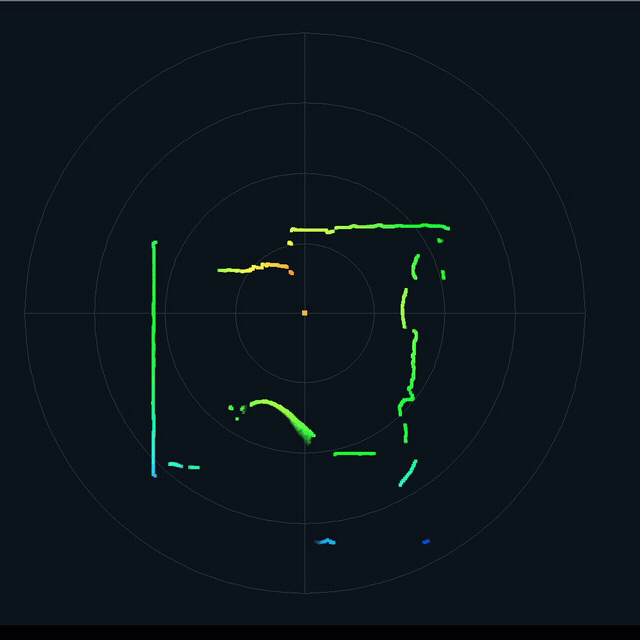

# RPLIDAR C1 Visualizer

A live 2D viewer for an RPLIDAR C1M1-R2 connected to a Raspberry Pi over USB. The C++ program uses the Slamtec SDK to read scans and SDL2 to draw the points.

## Demo

[](assets/rplidar-demo.mp4?raw=true)

[Download the full demo recording (MP4)](assets/rplidar-demo.mp4?raw=true)

## Build on Raspberry Pi OS

Open a terminal in this repository and run the following commands.

```bash
sudo apt update
sudo apt install build-essential git libsdl2-dev

git clone https://github.com/Slamtec/rplidar_sdk.git
make -C rplidar_sdk/sdk
make
```

If you already have a built SDK in `~/rplidar_sdk`, run `make RPLIDAR_SDK="$HOME/rplidar_sdk"` from this repository instead of cloning and building it again.

## Run

With the lidar connected, start the viewer from your Raspberry Pi desktop session.

```bash
./rplidar_visualizer
```

The program opens `/dev/ttyUSB0` at `460800` baud. If your adapter uses a different port, edit `SERIAL_PORT` near the top of `rplidar_visualizer.cpp` and run `make` again.

| Control | Action |
| --- | --- |
| Mouse wheel | Zoom in or out |
| `R` | Reset zoom |
| `Esc` | Exit |
